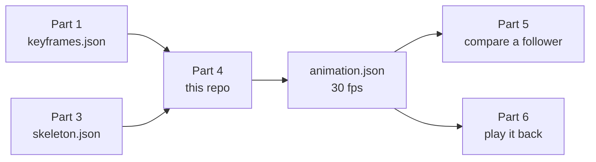
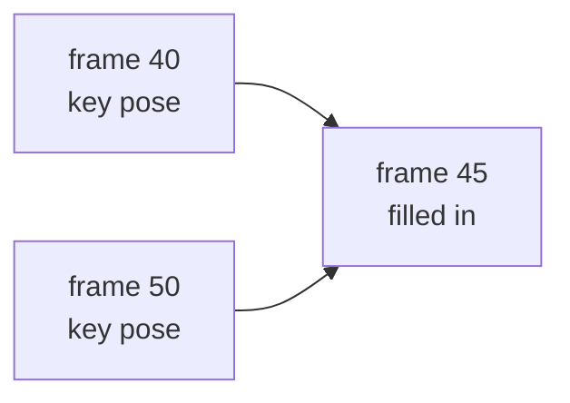
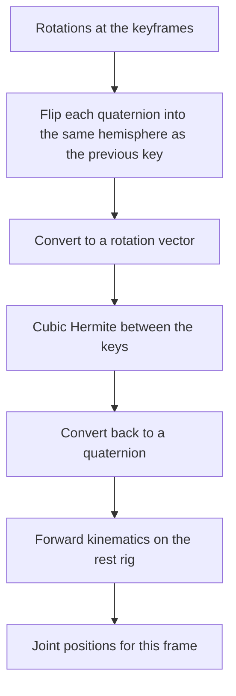

# Simon Part 4 — Animate 3D models between key frames

This repo turns a handful of 3D poses into a smooth 30 fps animation.

A trainer records a movement once. Part 1 marks the important moments (the keyframes). Part 3 supplies the skeleton at those moments. This part fills every frame in between and writes `animation.json`. Later, Part 5 compares a follower against that animation, and Part 6 plays it back.

This repo is only Part 4. It reads its own input files and writes its own output. It does not import the other parts. Hub repo: https://github.com/moalborati/simon. Source task: [moalborati/simon issue #58](https://github.com/moalborati/simon/issues/58). Scope: `docs/MINI-APPS.md` in that repo.

The behavior below is what this working branch ships. `main` updates when the Part 4 pull request merges.

## Where this part sits



Parts 1 and 3 can be missing. This repo ships fixtures of their files so the animation can be built and checked on its own.

## What goes in, what comes out

Each movement is one set under `fixtures/input/<set>/`.

| File | Who writes it | What this part uses |
| --- | --- | --- |
| `keyframes.json` | Part 1 | The 30 fps timeline and the key indices |
| `skeleton.json` | Part 3 | The local rotation at each of those keys |
| `coaching_note.txt` | authored with the fixture | Nothing in the animator. An optional offline voice hook can read it |

The animator writes one file:

`fixtures/output/<set>/animation.json`

Two sets ship with the repo.

| Set | Movement | Length | Frames | Keys | Frames filled in |
| --- | --- | ---: | ---: | ---: | ---: |
| `exercise` | squat | 3 s | 91 | 10 | 81 |
| `dance` | step-touch | 4 s | 121 | 13 | 108 |

The squat keys are frames 0, 10, 20, 30, 40, 50, 60, 70, 80, and 90. Frame 45, the bottom of the squat, is not a key. The curve builds it from the poses at frames 40 and 50.



## How one in-between frame is made

Rotations are quaternions `(x, y, z, w)`. A quaternion and its opposite describe the same pose, so the code first flips each key into the same hemisphere as the previous key. That stops a joint from spinning the long way when the author only meant a small step.

Each quaternion is then converted to a rotation vector: an axis times an angle in radians, kept in the range 0 to 180°. A cubic Hermite curve is fitted through those vectors. The slope at each key comes from the keys on either side (a Catmull-Rom tangent). At a key time the stored rotation is copied through, so the clip hits every authored pose. Between keys the curve supplies the rotation.

Joint positions are not blended. Blending positions would change the distance between joints and stretch the bones. The curve produces a rotation, and forward kinematics places the joints from a fixed rest rig. Bone lengths stay at those rest offsets for every frame.



The code that does this is `src/simon_anim/interpolate.py`. It uses the Python standard library only.

## The body and the coordinate frame

Seventeen joints are written into every frame, in this order:

nose, left_eye, right_eye, left_ear, right_ear, left_shoulder, right_shoulder, left_elbow, right_elbow, left_wrist, right_wrist, left_hip, right_hip, left_knee, right_knee, left_ankle, right_ankle.

Three extra joints exist only inside the rig so the limbs and the head have a parent: pelvis, chest, and neck. They are not written to `animation.json`.

Every frame is hip-centered. The origin is the midpoint of the two hips. Positions are metres.

```text
        y  up
        |
        |    z  forward
        |   /
        +--/---- x  subject's left
      hip midpoint
```

`z` is `x` cross `y`. In a squat the hips stay at the origin, so the feet rise toward the body as the knees bend. The body does not travel across the floor. That translation was already removed before this part sees the pose.

The rest lengths baked into the animator include a 0.42 m thigh, a 0.40 m shin, a 0.28 m upper arm, and a 0.25 m forearm. `skeleton.json` also carries `rest_offsets_m` and joint positions. The animator does not read them. It poses the built-in rig from `local_rotations`.

## What a frame looks like

`format` is `simon.animation.v1`. There is one frame per 30 fps tick. A key sample has `"interpolated": false`. A filled frame has `"interpolated": true`.

The standing squat, frame 0, is a key. The next tick is filled in:

```json
{ "index": 0, "t": 0.0, "interpolated": false }
{ "index": 1, "t": 0.033333, "interpolated": true }
```

Each frame also has a `joints` object. Values are metres `[x, y, z]`. On squat frame 0 the nose is `[0.0, 0.77, 0.04]`: centered, 0.77 m above the hips, 0.04 m forward. The other sixteen joints use the same shape.

## Edge cases

A new clip runs when both files sit in one directory, `fps` is 30, and the key indices in `keyframes.json` and `skeleton.json` are the same list in the same order. When `skeleton.json` includes a `joints` list, it must be the canonical 17 in the order above. The shipped squat and step-touch fixtures meet this. Their keys are 10 frames apart, both ends are keys, each key time matches `index / 30`, and the step from one key to the next stays under 120°.

### The file is rejected

- `fps` is anything other than 30.
- The key index lists differ, including a difference in order.
- The skeleton has no keyframes.
- A `joints` list is present and is not the canonical 17 in canonical order.

A missing `fps`, `frame_count`, `keyframes`, `index`, or `t` raises an error from the missing field.

### The file runs, and this is the result

- **A missing rotation, or a quaternion of all zeros.** That joint is treated as no rotation and stays on the rest pose. The clip still writes.
- **A key time that is not `index / 30`.** The authored pose is copied only when the two times match within a microsecond. Otherwise that frame is interpolated and can leave the authored pose.
- **No key on the first or last frame.** Frames before the first key, and frames after the last key, repeat the nearest key pose. They are marked `interpolated: true`.
- **A single key.** Every frame holds that pose.
- **More than 180° between two neighboring keys.** The rotation vector only represents the short arc, up to 180°. The joint turns the short way. A spin or a cartwheel inside one gap comes out as the opposite small turn.
- **Keys far apart on a fast bend.** The cubic can overshoot the arc between two keys. The 8° check passes for the shipped clips. It is not a promise for every spacing.
- **`duration_s` disagrees with `frame_count`.** Frame time is `index / 30`. `duration_s` is copied into the output and not checked. These clips use `frame_count = round(duration_s × 30) + 1`, so the last frame lands on the final key.
- **A duplicate time, a time that goes backward, or a key index outside the clip.** Sorting is by index. A zero-length step collapses to the left pose. A key past the last frame still pulls on the curve and never appears as its own output frame.
- **Different limb lengths or joint positions in `skeleton.json`.** The output uses the built-in rig. `make check-4` still compares key positions with the input and fails when they differ by more than 1 mm.

### Nothing in the keyframes can supply this

- **Which way a joint turned, once one gap is over 180°.** Two poses do not record the direction or the number of turns. Unwrapping can follow a long turn only when every single step between keys is under 180°.
- **A wiggle between the keys.** The hidden motion is not in the file. Denser keys are what keep the result inside 8°. Those keys come from Part 1.
- **A movement, when only one pose was provided.** The clip can hold the pose.
- **Travel across the floor.** The input is already hip-centered. This part cannot put the root path back.

## Definition of done

Hide the in-between frames. The animation must rebuild them within 8° per joint, and bone lengths must stay fixed.

`make check-4` prints a metrics JSON and exits 0 only when every threshold passes for both fixture sets:

- max joint direction error ≤ 8° on every held-out frame
- bone length within 1 mm of the rest rig
- hip midpoint within 1 mm of the origin
- keyframe positions reproduced, `interpolated` flags correct, and the shipped `animation.json` matches a fresh rebuild
- `meta_live_calls` is 0

Held-out ground truth lives in `fixtures/expected/<set>/held_out.json`. The animator does not read that directory. On the shipped clips the worst joint error is about 1.1° for the squat and about 2.7° for the step-touch, both under 8°, with bone-length error at 0.

`make check-4` scores `exercise` and `dance` only. Another set can be built with `--set`. It is scored after it is added to that list and given a held-out file.

## Run

Python 3.10+ and the standard library. No packages to install. Run these from the repo root.

```bash
make check-4          # both sets; metrics JSON on stdout; exit 0 only if every threshold passes
make animate          # rebuild both animation.json files from the keyframes
make fixtures         # regenerate inputs, held-out frames, and outputs from the analytic motions
```

Rebuild one clip:

```bash
PYTHONPATH=src python3 -m simon_anim.animate --set exercise
```

Watch either clip. From the repo root:

```bash
python3 -m http.server 8765
```

Open http://127.0.0.1:8765/demo/

Drag to orbit, scroll to zoom, space to play. The page loads `fixtures/output/<set>/animation.json`. Blue joints are the subject's left. Orange joints are the subject's right.

## Models sit beside the animation

Classical interpolation is the only path that writes `animation.json`, and the only path `make check-4` runs.

Optional Meta hooks can comment on the clip. They do not edit `animation.json`. A poster under `demo/posters/` is the exception, and that directory is gitignored. Live HTTP calls run only when `META_LIVE=1`. Local open-weight calls run only when `META_LOCAL=1`. A key by itself enables neither.

| Model | Role |
| --- | --- |
| `muse-spark-1.3` | Critique of keyframe spacing against the 8° budget |
| `muse-wonder-1.0` | Advisory phase plan from the keyframe names |
| `muse-image-1.0` | Optional demo poster |
| `muse-voice-transcribe-1.0` | Optional coaching-wav transcript. Offline, the authored note is returned and labeled offline |
| `sam-3.1` | Optional person segment for a demo overlay. No mask is invented offline |
| Muse Glimmer | Optional local caption (`META_LOCAL=1`, `GLIMMER_BASE_URL`). No weight download |
| Muse Spark Open | Optional local review of the interpolator (`META_LOCAL=1`, `SPARK_OPEN_BASE_URL`) |

Chat hooks use the developer role. The client floors `max_tokens` at 1024. Spark critique and Wonder plan request 2048, because reasoning tokens consume the budget first. A live smoke with 1024 returned `finish_reason=length` and empty content. A truncated reply is still logged, then re-raised.

Setup, commands, and prices: `docs/META_MODELS.md`. Spend ledger: `docs/meta-api-spend.md`. The ledger prints an alert when cumulative estimated spend crosses $5, $10, $15, and so on. A live smoke is logged on the machine where you set `META_LIVE=1`. `make check-4` does not call Meta.

## Rules

- Work only in this repo. Consume other parts through the shared files above. Use the fixtures until those parts exist.
- Every done-check goes through `make check-4`.
- Keep a fixture of `animation.json` in the repo so the next part can start.
