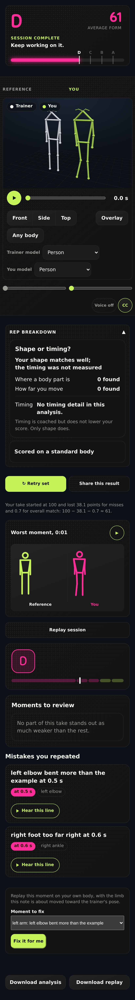

# Simon

[](https://github.com/moalborati/simon-part-7-stitching-app/actions/workflows/ci.yml)

Architecture on one page: [docs/ARCHITECTURE.md](docs/ARCHITECTURE.md), three diagrams with each node linked to its code.

Simon shows a student their movement beside their teacher's in 3D and points to where the two differ; a low score is not by itself a mistake.
It is for dance and movement teachers with remote students: the teacher records once, each student films
a take on a phone, and Simon shows both bodies side by side with timed notes on where the student differs.

Built for the Meta Global AI Developer Hackathon, theme **Push the Frontier**: SAM 3.1, SAM 3D Body and
Muse Spark give a machine a movement it has never been configured for, learned from one demonstration filmed
at any angle.



The screenshot is the committed example result (`#/result/fixture`), not a live run.
Demo video: link to be added at submission.

## For judges: try Simon on staging

Open <staging URL, sent separately> on a phone, or in a desktop browser with a webcam.

1. The browser asks for a username and password before Simon loads. Type the ones given to judges with the URL.
2. Home lists the movements. The featured take is the card at the top, "See a finished take": a scored squat, grade C, with both bodies in 3D.
3. To sign in, tap Sign in, type any email address and tap Send. On the next screen tap "Open the test mail outbox to get your code", tap Show, then tap the sign-in link. Me then says "Signed in as" with your address.
4. Tap the simon logo, tap a movement card, then tap "Follow this movement".
5. Tap "Open camera", allow the camera and do the movement in view, or tap "Upload a video".
6. Check the trim and tap Continue. Pick yourself if Simon asks. The analysis starts by itself after 60 s, or tap Analyse.
7. Wait on "Working on it" until the result opens.
8. Read the score and the timed notes, open the 3D view to see the trainer and you on one clock, and scroll to "How this was made" for the Meta models that ran.
9. Tap "Share this result", tap Create link and copy the link.

Limits you will meet:
- A share link opens only with the staging login, so whoever you send it to needs the same username and password.
- The wait: the recorded run took 7 minutes from upload to result, and a take waits longer while another job holds the GPU.
- Parts 1 to 6 are private repositories, so their submodule links and a recursive clone need access. Without that access CI still runs, skips the tests that need the parts, and says how many it skipped.

This path was walked on staging through the real UI (recipe `qa/recipes/judge-path.yaml`, run `20261102162151` on build `333aefca5`, and the second pass `20261102163616-result`; evidence `qa/evidence/judge-path/` on branch `lane/qa-auth-r20`). The hero card text was checked on build `3c9cf0904` (run `20261102184554`).

## How it works

The teacher's recording runs through Parts 1 to 4 and 6; a student's take runs through Parts 2, 3 and 5. Each part is a separate repo,
included here as a git submodule under `modules/`, and Part 7 runs it as a process and passes files.

| Step | What happens | Meta model |
|---|---|---|
| 1 Part 1, keyframes | Finds the repetitions and names their phases in the teacher's clip | Muse Spark 1.3 watches the video and names the phases. SAM 3.1 (Meta Model API) tracks the person; the silhouette sets the times. |
| 2 Part 2, images to 3D | 3D joints for every frame from one phone camera | SAM 3.1 picks the person. SAM 3D Body (DINOv3 backbone, MHR body model) gives the 3D pose. |
| 3 Part 3, skeleton | One consistent skeleton from the joints | None |
| 4 Part 4, animation | The teacher's reference animation | None in the app path |
| 5 Part 5, fault analysis | Compares student and teacher, finds faults with times, scores 0 to 100 | Muse Spark Open (hosted on Baseten) writes each measured fault as one sentence. A validator holds it to the measured facts and falls back to a template. |
| 6 Part 6, catalog and player | Stores the reference, plays 3D in the browser | None |
| 7 Part 7, this repo | The phone app, job queue and GPU lock that join the six | Muse Voice Transcribe 1.0 (Meta) turns the trainer's narration into timed cues when an upload has sound. Meta MMS-TTS runs locally to speak feedback lines when spoken feedback is on. For the Me page, Part 7 runs Part 2's SAM 3D Objects (a textured model from one picture) and SAM 3D Body with the MHR body model (a rigged body from photos, or a skeleton for an unrigged mesh). |

Every Meta model with its evidence: [docs/submission.md](docs/submission.md), "Use of Meta AI tooling". Source for each row: the model audit of 2026-10-31 (`docs/audit/rubric-2026-10-31/meta-ai.md`, kept in the
development workspace) and the licence table in `modules/part-2/README.md`.

The teacher's recording, not an AI model, is the reference. Simon measures how far the student's movement is from it
and reports the differences in plain words with the time they happen. A large difference is not by itself a mistake.

## How accurate is Simon

Full table with every source: [docs/evaluation.md](docs/evaluation.md).

<!-- eval-report:accuracy:begin -->
| Layer | Result | Source |
|---|---|---|
| 3D pose, 20 hand-labelled frames | 3.84% of body height mean 2D reprojection error, max 4.88% | `bench/results/2026-11-02/part2-check.json`, block `one_person` |
| 3D pose, 20 COCO images | 2.02% mean, max 4.90% | same, block `one_person_coco` |
| Fault finding, good light, held-out seeds 29, 31, 37, 67, 71, 73 | precision 0.88 to 1.00, recall 0.83 to 1.00 at front, 45 degrees and side | `bench/results/2026-11-02/part5-heldout-attempts.json` |
| App path against a direct run of Parts 2 to 5 | latest recorded run `20261102T021153Z` at `17adac8`: `pass` false; passed in 4 of 17 recorded runs | `bench/results/`, `check7-runs.json` |
| Real people, physiotherapist labels (REHAB24-6, interim, 40 of 120 reps, 2026-11-02), reference by another person | score AUC 0.43 (0.31 to 0.54), 0.5 is chance; 21 of 22 correct reps flagged | `docs/audit/eval-public-2026-11/details.json`, `trainer-rehab` |
| Same, reference by the person's own correct rep | score AUC 0.68 (0.58 to 0.79); 11 of 22 correct reps flagged | same, `same-rehab` |
| Same correct reps, another person's reference instead of their own | mean score 48.1 (95% 36.9 to 64.0) points lower | same, `body_invariance` |
| Motion capture, pre-registered leave-one-person-out (REHAB24-6, 1057 reps), one other person's correct rep | AUC 0.58 (0.54 to 0.63); recall 0.23 at 80% specificity | `docs/audit/kcurve-2026-11-02/results.json`, `pooled.a` |
| Same, an envelope over 4 to all available other people (up to 8) | AUC 0.64 to 0.66; recall 0.36 to 0.46 | same, `pooled.b4` to `pooled.bmax` |
| Same, the person's own correct rep | AUC 0.77 (0.73 to 0.82); recall 0.61 | same, `pooled.c` |
| Simon's video pipeline, 41 follower reps, motion-capture envelope of all other people | AUC 0.375 (0.161 to 0.546); the interval includes 0.5 | `docs/audit/kcurve-2026-11-02/pipeline-summary.json` |
| Simon's video pipeline, pre-registered, the person's own correct rep (REHAB24-6, 38 reps, 7 people) | AUC 0.70 (0.65 to 0.86); shuffled-label p 0.007; recall 0.41 at 80% specificity | `docs/audit/ownref-video-2026-11-02/results.json`, `A.video` |
| Same pairs on motion capture | AUC 0.84 (0.73 to 0.94) | same, `A.mocap` |
| Paired before and after on video (a measurement proxy, not coaching): a correct take and an incorrect one, both against the person's held-out correct rep | correct above incorrect for 6 of 6 people, median +12.6 points; Wilcoxon one-sided p 0.016 | same, `B.video` |
| Same, all motion-capture reps | 10 of 10 people, median +20.4 points | same, `B.mocap_full` |
| Synthetic bodies, one squat on 11 body shapes, 57 renders (interim) | clean score spread 55.5 points across shapes; 9 of 57 renders scored 0 | `bench/results/2026-11-02/mhr-bench.json` |
| 3D joints on those bodies, mean per camera angle | MPJPE 80 to 111 mm, PA-MPJPE 58 to 69 mm | same |
| Planted knee fault on those bodies | found front 5 of 9, 45 degrees 0 of 10, side 0 of 10 | same |
<!-- eval-report:accuracy:end -->

The Part 5 fault rows use synthetic planted faults. The rows below them come from real people and from bodies of
known shape. The first three real-people rows are a pre-registered leave-one-person-out run on REHAB24-6 motion
capture (CC BY-NC 4.0), the cleanest test of the reference idea because no pose estimator is involved; the
pre-registration and every number are in [docs/audit/kcurve-2026-11-02/](docs/audit/kcurve-2026-11-02/). The
"interim, 40 of 120 reps" rows are an earlier, smaller run of the full video pipeline. They are kept as the video
citation for Simon's own score with another person's rep or the person's own rep; the motion-capture rows are the
newer, larger measurement. The two are not merged. The four rows after the video envelope row are a second
pre-registered run, the person's own correct rep on Simon's video pipeline; the pre-registration and every number are
in [docs/audit/ownref-video-2026-11-02/](docs/audit/ownref-video-2026-11-02/).

- **Motion capture, 1057 reps (pre-registered).** Another person's correct rep as the reference gave an AUC of 0.58
  (recall 0.23 at 80% specificity); 0.5 is chance. An envelope built from several correct people helps a little: 0.64
  with 4 people, 0.66 with 6 or with all available (up to 8). The person's own correct rep is the strongest reference,
  0.77.
- **Simon's video pipeline, 41 reps.** The same envelope, with every available other person as the reference, gave
  an AUC of 0.375 (0.161 to 0.546). The interval includes 0.5, so the set of reference people did not make the
  score useful on video, although on clean motion capture the same method reached 0.66. That gap points to pose
  error as the main limit today. This video run used one setting (all available people), not a sweep.
- **Simon's video pipeline, the person's own rep (pre-registered).** This is what My reference does: the teacher
  approves one of the student's reps, and later takes are compared with it. With another correct rep by the same
  person as the reference, Simon's score on video separated physiotherapist-labelled incorrect reps from correct ones
  better than a label shuffle within each person did. The same pairs on motion capture scored higher, so pose error
  still costs accuracy. Most references came from the same recording session, which is easier than a reference
  recorded on another day, and the sample is small, so this shows that own-rep comparison works on video, not a
  precise accuracy figure. A paired before and after on the same data put the correct take above the incorrect one
  for every person. That part is a measurement proxy, not coaching: the mistakes in REHAB24-6 were acted, and nobody
  received a cue between takes.
- **Earlier interim run, video, 40 of 120 reps.** The reference was a correct rep by another person, as when a student
  follows a teacher's recording. The score did no better than chance and nearly every correct rep was flagged. With
  the person's own correct rep as the reference, the score separated correct from incorrect better than chance and
  half the correct reps were flagged. Swapping in another person's rep costs most of the score on a correct rep, and
  the cause is mostly how two people perform the same correct exercise, not their height. Method and every table:
  [docs/audit/eval-public-2026-11/README.md](docs/audit/eval-public-2026-11/README.md).
- **Synthetic bodies.** One squat, identical in joint angles, rendered on 11 body shapes with known 3D joints. The
  clean score still changes with the body shape, some renders of the unchanged movement scored 0, and the planted knee
  fault was found only from the front.

What this means today: Simon is not validated for judging a student against a different person's recording. Even on
clean motion capture, comparing with another person's rep is weak (0.58); a set of correct reps helps a little (0.64
to 0.66); the student's own rep is strongest (0.77), and on video it is the only reference that has beaten chance in
a pre-registered run. On video, pose error dominates today, so better pose accuracy is the main lever. The score also varies with body shape. A fix is in progress with Part 5. The video samples are small
(41, 40 and 38 reps), and the video pipeline has not been run on the full dataset. See "Limits" below.

## How long it takes

Staging job summaries since the release 20 live build, test jobs left out (details in [docs/evaluation.md](docs/evaluation.md)).

<!-- eval-report:latency:begin -->
| Job | n | p50 | p95 | Longest stage |
|---|---|---|---|---|
| Analyse a follower take (`follow`) | 1 | 106.0 s | 106.0 s | pose |
| Choose the person (`people`) | 4 | 93.2 s | 126.5 s | track |
| Trainer recording (`trainer`) | 1 | 110.1 s | 110.1 s | pose |
<!-- eval-report:latency:end -->

A resident Part 2 worker cut the 3D step from 97.1 s to 51.7 s mean over three runs each on an RTX 5090
(commit `1d54206`).

## Try it without a GPU

```bash
git clone --recursive https://github.com/moalborati/simon-part-7-stitching-app.git
cd simon-part-7-stitching-app
make dev
```

Open `http://127.0.0.1:8727/#/result/fixture`. This is the result screen on a committed example: score,
the two bodies in 3D (front, side, top, overlay) and the timed notes. It needs no GPU and no keys. The app needs Python 3.12, [uv](https://docs.astral.sh/uv/), `git`, `make` and `ffmpeg`.

Real jobs need a CUDA GPU with 12 GB free, `make parts` to set up Parts 1 to 6, and keys for the Meta
Model API. [docs/dev/DEVELOPING.md](docs/dev/DEVELOPING.md) covers setup, keys, running and debugging.

## Tests

```bash
uv run pytest -q                              # Python tests, no GPU
node --test tests/part7/*.unit.test.mjs       # browser-module unit tests
make check-7                                  # the done-check: app path against a direct run (needs the GPU setup)
```

`uv run pytest -q`, the node tests and the linter are set to run in CI on every push ([workflow](.github/workflows/ci.yml)), but all 17 runs listed by `gh run list` on 2026-11-02 (UTC) failed at checkout: Parts 1 to 6 are private repositories, and the workflow cannot read them without the `PARTS_READ_TOKEN` secret. That is why the badge above is red. Run the commands above locally instead.

## Limits

- Camera angle and occlusion: the pose comes from one phone camera. A body part hidden from the lens is
  estimated, and a side view hides the far limb. Part 5 refuses a take whose moving part is out of frame.
- 17 joints plus 6 foot points are kept. There is no ankle twist, no hand or finger detail and no face.
  SAM 3D Body also gives a full body mesh: the result draws both people as overlaid meshes with the faulty limb tinted. The scoring uses the joints only.
- A take is analysed after it is recorded, not live. A student waits about three to four minutes (picker plus analysis).
- Accuracy is shown on synthetic planted faults, and Part 5's seed 37 check failed on one correct take (a
  false right-ankle note in a side view). Details in [docs/evaluation.md](docs/evaluation.md).
- `make check-7` is not stable yet: it passed once, and later runs failed `score_equal` on one take (see the accuracy table above).
- One standard body of 1.70 m is used for everyone, so that height and limb length should not change the score. The interim synthetic body bench shows the score still varies with body shape, and the planted knee fault was missed at 45 degrees and from the side; `docs/submission.md` says where this stops.
- A model made from a picture, or rigged automatically on import, can show stretched skin at the hips when its hands touch its body (TICKET-333; fix in review).
- A follow take can be refused by Part 5's rep-by-rep step when the trainer clip holds a single long rep and the follower does many (Part 5 TICKET-106, fixed in Part 5 1.14.2); the message overstates the size. Record the trainer with a few reps.
- Knee valgus (knees falling inward) is read reliably only from the front. On Part 5's bench a planted 15 degree valgus reads 12.4 degrees from the front, 2.4 at 45 degrees and 1.3 from the side (Part 5 TICKET-092). From a 45 degree or side take, a knee valgus fault is weak evidence and its absence is no evidence.
- Teacher to student is not validated. With another person's correct rep as the reference, motion capture of 1057 rehabilitation reps gave an AUC of 0.58 (pre-registered, `docs/audit/kcurve-2026-11-02/`), and Simon's video pipeline was at chance on small samples (41 and 40 reps). The strongest case is a person against their own correct rep: 0.77 on motion capture, and on video a pre-registered run beat a label shuffle on a small sample whose references mostly came from the same recording session (`docs/audit/ownref-video-2026-11-02/`). On video, pose error dominates.
- Simon is not a health tool and gives no health advice.

## Practice modes and challenges

Besides the main journey the app has three practice modes, each with its own scoring profile in Part 5, learn-in-sections for hard routines, challenges with a shareable result card, crew
leaderboards and brand-sponsored challenges. They are built and sit behind the same result screen; see
[docs/features/README.md](docs/features/README.md).

## More

- [docs/dev/DEVELOPING.md](docs/dev/DEVELOPING.md): set up a host, run the app, debug a job.
- [docs/design/](docs/design/README.md): specs and decisions behind the code.
- [docs/submission.md](docs/submission.md): the hackathon write-up, by judging criterion.
- Licence: to be decided; see the team.
- `CONTRACT.md`: the files Part 7 reads and writes.
- [Task brief (from the team)](#task-brief-from-the-team): the client's original task, rules and definition of done.
- Hub repository with all seven parts: https://github.com/moalborati/simon

## Task brief (from the team)

The client's original brief for this part (moalborati/simon issue #61), kept verbatim from the upstream README (cbeec87, 90aa473) and restored by TICKET-118. `CLAUDE.md` points here.

Part of **Simon** → hub repo: https://github.com/moalborati/simon (scope and the other parts live there; this repo is only this part).
This repo is **only** Simon Part 7. It is a black box: it reads its input files and writes its output files, and knows nothing about the other parts. Keep it that way: that isolation is what lets agents work here with a small context.

Simon in one line (all you need): a trainer records an expected movement once; a follower performs it to camera; the follower's 3D movement is compared against the expected one and the differences are reported in plain words. This part is one step of that.

Source task: moalborati/simon issue #61. Scope source: `docs/MINI-APPS.md` in moalborati/simon (Part 7).

## Input

The outputs of Parts 1–6, consumed only through their shared files (`keyframes.json`, `tracks.json`, `pose3d.json`, `skeleton.json`, `animation.json`, `analysis.json`, catalog entries).

## Output

The Simon app: pick (or record) an expected movement from the catalog → watch its animation → perform it to camera → get the Part 5 fault analysis.

## Shared-file context (only what this part touches)

Black-box rule is strictest here: this repo calls the other parts through their files/demos only. No importing another part's code.

## Frontier model

none (stitches Parts 1–6 through their shared files)

## Definition of done

End to end on a movement the app was never hand-configured for: record it via Part 6, follow it, and the faults reported match running Parts 2–5 directly on the same recorded follower clip.

Done-check: `make check-7` prints a metrics JSON and exits 0 only when every threshold passes. Write the check as part of this work; until it exists, the stub in the Makefile fails honestly.

## Demos

- **Isolated:** n/a, this part is the integrated demo.
- **Integrated:** The submission demo: one take records an exercise, a follower is analysed against it.

## Rules

- Work only in this repo. Do not copy or import another part's code; consume other parts only through the shared files above, using fixtures until they exist.
- Every run of the done-check goes through `make check-7`.
- Fixtures of your inputs live in `fixtures/input/`; ship a fixture of your output so the next part can start.
