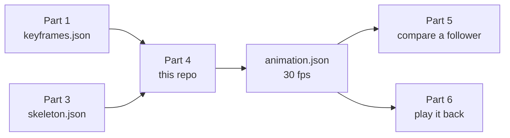
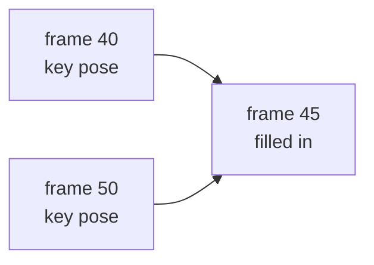
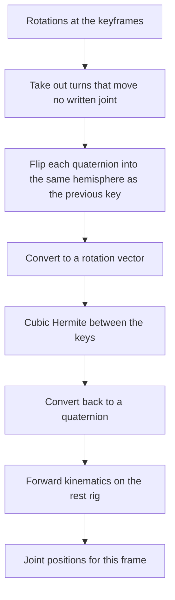

# Simon Part 4 — Animate 3D models between key frames

This repo turns a handful of 3D poses into a smooth 30 fps animation.

A trainer records a movement once. Part 1 marks the important moments (the keyframes). Part 3 supplies the skeleton at those moments. This part fills every frame in between and writes `animation.json`. Later, Part 5 compares a follower against that animation, and Part 6 plays it back.

This repo is only Part 4. It reads its own input files and writes its own output. It does not import the other parts. Hub repo: https://github.com/moalborati/simon. Source task: [moalborati/simon issue #58](https://github.com/moalborati/simon/issues/58). Scope: `docs/MINI-APPS.md` in that repo.

## Where this part sits



Parts 1 and 3 can be missing. This repo ships fixtures of their files so the animation can be built and checked on its own.

## What goes in, what comes out

The animator reads `fixtures/input/` and writes `fixtures/output/`. `fixtures/expected/` is the answer key for the test. The animator does not read it.

| Directory | File | Role |
| --- | --- | --- |
| `fixtures/input/<set>/` | `keyframes.json` | Part 1's timeline: which frames are keys |
| `fixtures/input/<set>/` | `skeleton.json` | Part 3's body and the pose at those keys |
| `fixtures/input/<set>/` | `coaching_note.txt` | Optional offline voice hook. The animator ignores it |
| `fixtures/output/<set>/` | `animation.json` | This part. Every frame at 30 fps |
| `fixtures/expected/<set>/` | `held_out.json` | `make check-4` only. The hidden in-between poses |

`expected` stays in its own directory so the check measures the curve. Those poses are the correct in-between frames.

Five clips ship with the repo. `make check-4` scores the first three against hidden frames and holds `part3-squat` to the key, bone and output rules. The one-minute clip is there to watch.

| Set | Movement | Length | Frames | Keys | Frames filled in | Scored |
| --- | --- | ---: | ---: | ---: | ---: | --- |
| `exercise` | squat | 3 s | 91 | 10 | 81 | yes |
| `dance` | step-touch | 4 s | 121 | 13 | 108 | yes |
| `long` | ten squats | 30 s | 901 | 71 | 830 | yes |
| `minute` | twenty squats | 60 s | 1801 | 141 | 1660 | no |
| `part3-squat` | two squats, Part 3's real output | 7.07 s | 213 | 6 | 207 | keys and bones only |

`part3-squat` is Part 3's `--view part4` output for Part 2's squat, with Part 1-shaped keys, copied unedited. `fixtures/input/part3-squat/SOURCE.md` names the commit, the command and the hashes.

The squat keys are frames 0, 10, 20, 30, 40, 50, 60, 70, 80, and 90. Frame 45, the bottom of the squat, is not a key. The curve builds it from the poses at frames 40 and 50.



## How one in-between frame is made

Rotations are quaternions `(x, y, z, w)`. Each key is first put on the shortest arc from the key before it:

- A turn that moves no written joint is taken out. An elbow, knee or eye loses its twist about the bone to its only child (wrist, ankle, ear), against the previous key. A wrist, ankle or ear has no child, so its rotation is held at the identity. Key positions do not change.
- A quaternion and its opposite describe the same pose, so the key is flipped into the same hemisphere as the previous key. That stops a joint from spinning the long way when the author only meant a small step.

Each quaternion is then converted to a rotation vector: an axis times an angle in radians. The flipped sign is kept, so the angle runs from 0 to 360° and a joint that turns through 180° (an arm lifted just past overhead) stays next to its previous key. That conversion, and the slope at each key, is done once for the whole clip.

Why the twist goes first: a folded elbow whose forearm swings around the upper arm (Part 2's seated side stretch) moves the forearm about 25° per key, but the elbow's own swing changes axis by 80° and its rotation vector jumps more than 180°. Before this step that key pair was refused, and Part 3 had to add a shoulder twist to get through (its ASM-020). With the twist taken out, the step is the forearm's real movement. A cubic Hermite curve uses those slopes (a Catmull-Rom tangent from the keys on either side). At a key time the stored rotation is copied through, so the clip hits every authored pose. Between keys the curve supplies the rotation.

Joint positions are not blended. Blending positions would change the distance between joints and stretch the bones. The curve produces a rotation, and forward kinematics places the joints from a fixed rest rig. Bone lengths stay at those rest offsets for every frame.



The code that does this is `src/simon_anim/interpolate.py`. It uses the Python standard library only.

## The body and the coordinate frame

Seventeen joints are written into every frame, in this order:

nose, left_eye, right_eye, left_ear, right_ear, left_shoulder, right_shoulder, left_elbow, right_elbow, left_wrist, right_wrist, left_hip, right_hip, left_knee, right_knee, left_ankle, right_ankle.

Two extra joints exist only inside the rig: pelvis, which is the root, and neck. The collarbones and the head leave the neck. They are not written to `animation.json`.

Every frame is hip-centered. The origin is the midpoint of the two hips. Positions are metres.

```text
        y  up
        |
        |    z  forward
        |   /
        +--/---- x  subject's left
      hip midpoint
```

`z` is `x` cross `y`. In a squat the hips stay at the origin, so the feet rise toward the body as the knees bend. The body does not travel across the floor. That translation was already removed before this part sees the pose.

Bone lengths come from `rest_offsets_m` in `skeleton.json`. Those lengths are the Part 3 standard for a 1.7 m body: thigh 0.4165 m, shank 0.4182 m, upper arm 0.3162 m, forearm 0.2482 m, spine 0.4896 m. Each key also stores a confidence on every joint, and the file carries the scalar `bone_lengths_m` table, the bone list, and the stature sources. The twists that the curve needs are stored beside the positions. The 30 s clip scales that same body by 1.15. The one-minute clip keeps the unscaled 1.7 m body. The animator poses whichever body is in the file. Joint positions are checked against that pose. They are not blended to make the in-between frames.

## Contract

`CONTRACT.md` lists every field, unit and rule of the three files, and what Parts 1, 3, 5 and 6 send or read. The schemas are `contracts/keyframes.schema.json`, `contracts/skeleton.schema.json` and `contracts/animation.schema.json` (JSON Schema draft 2020-12). The animator checks both inputs against them before it reads anything.

## What a frame looks like

`format` is `simon.animation.v1` and `producer` is `"part4"`, so a reader can tell Part 4's file from a copy or a stand-in. There is one frame per 30 fps tick. A key sample has `"interpolated": false`. A filled frame has `"interpolated": true`.

The standing squat, frame 0, is a key. The next tick is filled in:

```json
{ "index": 0, "t": 0.0, "interpolated": false }
{ "index": 1, "t": 0.033333, "interpolated": true }
```

Each frame also has a `joints` object. Values are metres `[x, y, z]`. On squat frame 0 the nose is `[0.0, 0.675416, 0.042881]`: centered, 0.675 m above the hips, 0.043 m forward. The other sixteen joints use the same shape.

## Joints the camera never saw (optional)

Part 3 writes conf 0.3 for a joint that was outside the image. Part 4 still computes a position for
it from the rest rig, so the file also says which joints were not measured. Two optional fields carry
that, and nothing else in the file changes:

```json
{ "unseen_joints": ["right_ankle"],
  "frames": [ { "index": 1, "interpolated": true, "joints": { "...": "..." },
                "conf": { "nose": 1.0, "...": 1.0, "left_ankle": 1.0, "right_ankle": 0.3 } } ] }
```

- `frames[].conf` maps all 17 joints to a number in 0..1, the shape Part 5 already reads from follower files.
- A key frame carries its key's values. A filled frame carries the minimum of the two keys on either side, so a joint unseen at one end of a gap stays unseen across it. Frames outside the first and last key hold the nearest key.
- `unseen_joints` lists the joints at or below 0.3 at every key, in canonical order.
- The values come from `keyframes[].conf` in `skeleton.json`, else from the `conf` of a `{x, y, z, conf}` joint. When every joint is 1.0 at every key, or the input has no conf, neither field is written and `animation.json` is unchanged. A reader treats a missing `conf` as seen.

`part3-squat` shows it: its right ankle is 0.3 at every key, so `unseen_joints` is `["right_ankle"]`.

## Edge cases

A new clip runs when both files sit in one directory, each meets its schema in `contracts/`, `fps` is 30, `frame_count` is `round(duration_s × 30) + 1`, and the key indices in `keyframes.json` and `skeleton.json` are the same strictly increasing list. Each key index lies inside the clip, and its `t` matches `index / 30` within a microsecond. `rest_offsets_m` must include every joint of the standard rig, with that joint's parent unchanged. When `skeleton.json` includes a `joints` list, it must be the canonical 17 in the order above. The shipped clips meet this. The short ones place a key every 10 frames. The 30 s clip and the one-minute clip space keys unevenly, from 7 to 16 frames apart, and repeat that pattern on every 3 s squat. The 30 s clip uses the larger body.

### The file is rejected

The clip is not written. The error names the joint or the frame.

- A file breaks its schema: a missing field, a `format` other than `simon.keyframes.v1` or `simon.skeleton.v1`, a key without `joints` or `local_rotations`, or a value of the wrong type. The error names the file, the schema and the field path.
- `fps` is anything other than 30, or `frame_count` does not match the duration.
- The key index lists differ, a key is repeated or out of order, or a key sits outside the clip.
- A key time differs from `index / 30` by more than a microsecond.
- The skeleton has no keyframes, or `rest_offsets_m` is missing a joint or gives a joint the wrong parent.
- A `joints` list is present and is not the canonical 17 in canonical order.
- **A missing rotation, or a quaternion of all zeros.** The joint would otherwise freeze on the rest pose.
- **More than 180° between two neighboring keys in rotation-vector space, after the shortest arc above.** The curve would take the long way around. Two large turns about very different axes in one gap (170° about x, then 170° about z) are this case, and so is a joint that keeps spinning until its angle nears 360°. A folded elbow swinging about the upper arm, or a joint passing through 180°, is not. The error names the joint and the two frame indices.

A missing `fps`, `frame_count`, `keyframes`, `index`, or `t` is a schema error that names the missing field.

### The file runs, and this is the result

- **No key on the first or last frame.** Frames before the first key, and frames after the last key, repeat the nearest key pose. They are marked `interpolated: true`.
- **A single key.** Every frame holds that pose.
- **Keys far apart on a fast bend, while each step stays under 180°.** The cubic can overshoot the arc between two keys. The 8° check passes for the shipped clips, including the uneven 30 s gaps. It is not a promise for every spacing.

### Nothing in the keyframes can supply this

- **Which way a joint turned, once one gap is over 180°.** Two poses do not record the direction or the number of turns. The curve takes the short way. It cannot tell a 190° turn from a 170° turn the other way.
- **A wiggle between the keys.** The hidden motion is not in the file. Denser keys are what keep the result inside 8°. Those keys come from Part 1.
- **A movement, when only one pose was provided.** The clip can hold the pose.
- **Travel across the floor.** The input is already hip-centered. This part cannot put the root path back.

## Definition of done

Hide the in-between frames. The animation must rebuild them within 8° per joint, and bone lengths must stay fixed.

`make check-4` prints a metrics JSON and exits 0 only when every threshold passes for every fixture set:

- max joint direction error ≤ 8° on every held-out frame
- bone length within 1 mm of the rest rig
- hip midpoint within 1 mm of the origin
- keyframe positions reproduced, `interpolated` flags correct, and the shipped `animation.json` matches a fresh rebuild
- every fixture meets its schema in `contracts/`, and those files match `src/simon_anim/contract.py`
- `meta_live_calls` is 0

Held-out ground truth lives in `fixtures/expected/<set>/held_out.json`. The animator does not read that directory. On the scored clips the worst joint error is about 1.1° for the squat, about 4.2° for the step-touch, and about 3.1° for the 30 s repeated squat. All three are under 8°, with bone-length error at 0. The long clip's bones follow the larger body in its `skeleton.json`.

`make check-4` scores `exercise`, `dance`, and `long`, and checks `part3-squat` for key positions within 1 mm, fixed bone lengths, flags and the shipped file. It also reports, without a threshold, how far that clip sits from Part 3's own frames between the keys. The `minute` clip has a held-out file and plays in the demo. It is left off that score list. Another set is scored after it is added to the list in `src/simon_anim/check.py`.

## Run

Python 3.10+ and the standard library. No packages to install. Run these from the repo root.

```bash
make check-4          # exercise, dance, long and part3-squat; metrics JSON on stdout; exit 0 only if every threshold passes
make test             # contract tests: schemas, fixtures, and what the loader rejects
make animate          # rebuild the exercise, dance, long and part3-squat animation.json files
make fixtures         # regenerate the synthetic clips, including the one-minute squat
make contracts        # rewrite contracts/*.schema.json from src/simon_anim/contract.py
make part3-squat PART3=../simon-part-3-skeleton-consistency   # refresh the Part 3 clip from a Part 3 clone
```

Rebuild one clip:

```bash
PYTHONPATH=src python3 -m simon_anim.animate --set exercise
PYTHONPATH=src python3 -m simon_anim.animate --set minute
PYTHONPATH=src python3 -m simon_anim.animate --in <dir with skeleton.json and keyframes.json> --out <dir>/animation.json
```

Watch a clip. From the repo root:

```bash
python3 -m http.server 8765
```

Open http://127.0.0.1:8765/demo/

Drag to orbit, scroll to zoom, space to play. The clip menu lists the squat, the step-touch, the 30 s squat, the one-minute squat, and Part 3's squat. The page loads `fixtures/output/<set>/animation.json`. Blue joints are the subject's left. Orange joints are the subject's right.

## Models sit beside the animation

Classical interpolation is the only path that writes `animation.json`, and the only path `make check-4` runs.

Optional Meta hooks can comment on the clip. They do not edit `animation.json`. A poster under `demo/posters/` is the exception, and that directory is gitignored. Live HTTP calls run only when `META_LIVE=1`. Local open-weight calls run only when `META_LOCAL=1`. A key by itself enables neither.

| Model | Role |
| --- | --- |
| `muse-spark-1.3` | Critique of keyframe spacing against the 8° budget |
| `muse-wonder-1.0` | Advisory phase plan from the keyframe names |
| `muse-image-1.0` | Optional demo poster |
| `muse-voice-transcribe-1.0` | Optional coaching-wav transcript. Offline, the authored note is returned and labeled offline |
| `sam-3.1` | Optional person segment for a demo overlay. No mask is invented offline |
| Muse Glimmer | Optional local caption (`META_LOCAL=1`, `GLIMMER_BASE_URL`). No weight download |
| Muse Spark Open | Optional local review of the interpolator (`META_LOCAL=1`, `SPARK_OPEN_BASE_URL`) |

Chat hooks use the developer role. The client floors `max_tokens` at 1024. Spark critique and Wonder plan request 2048, because reasoning tokens consume the budget first. A live smoke with 1024 returned `finish_reason=length` and empty content. A truncated reply is still logged, then re-raised.

Setup, commands, and prices: `docs/META_MODELS.md`. Spend ledger: `docs/meta-api-spend.md`. The ledger prints an alert when cumulative estimated spend crosses $5, $10, $15, and so on. A live smoke is logged on the machine where you set `META_LIVE=1`. `make check-4` does not call Meta.

## Rules

- Work only in this repo. Consume other parts through the shared files above. Use the fixtures until those parts exist.
- Every done-check goes through `make check-4`.
- Keep a fixture of `animation.json` in the repo so the next part can start.
