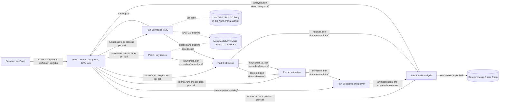
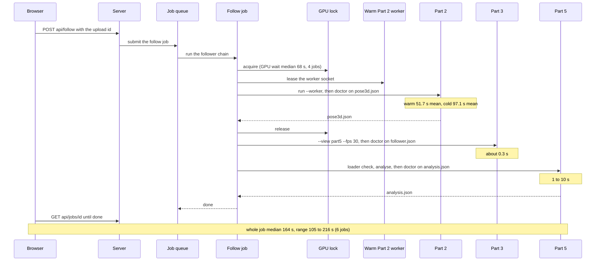
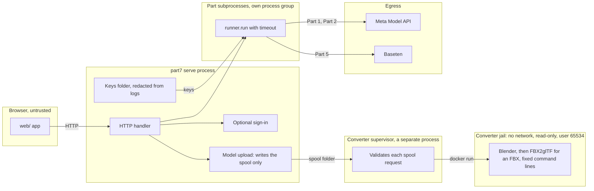

# Architecture

Simon is seven parts. Parts 1 to 6 are folders under `modules/` in this repo (ADR-0008), and Part 7 runs each one as a
separate process and passes files between them. The three diagrams below show the parts and their contract files,
one follow job from upload to result, and where the trust boundaries sit. Every node has a row in the table under its
diagram that links to the file and line it stands for.

`tools/arch_check.py` keeps this page honest. It fails CI when a diagram names a part, file, symbol or contract that
the code no longer has; `python3 tools/arch_check.py --fix` moves a link to the symbol's new line.

## System view

Each arrow carries the contract file a part writes and, where its schema fixes one, the format string. Dotted arrows
show where each model runs.

The trainer's recording takes Parts 1, 2, 3 and 4 and lands in Part 6's catalog. A student's take takes Parts 2, 3
and 5. When the Meta Model API refuses Part 1, Part 3's every-10 keyframes stand in for it.

| Node | Code | Symbol |
|---|---|---|
| WEB | [web/api.js:62](../web/api.js#L62) | `request` |
| P7 | [part7/server.py:92](../part7/server.py#L92) | `App` |
| P1 | [part7/parts/p1_keyframes.py:237](../part7/parts/p1_keyframes.py#L237) | `run` |
| P2 | [part7/parts/p2_pose.py:718](../part7/parts/p2_pose.py#L718) | `run` |
| P3 | [part7/parts/p3_skeleton.py:139](../part7/parts/p3_skeleton.py#L139) | `part4` |
| P4 | [part7/parts/p4_animate.py:50](../part7/parts/p4_animate.py#L50) | `run` |
| P5 | [part7/parts/p5_analyse.py:98](../part7/parts/p5_analyse.py#L98) | `run` |
| P6 | [part7/parts/p6_catalog.py:82](../part7/parts/p6_catalog.py#L82) | `Child` |
| GPU | [part7/p2_worker.py:157](../part7/p2_worker.py#L157) | `Pool` |
| MMA | [part7/keys.py:35](../part7/keys.py#L35) | `KEY_NAMES` |
| BT | [part7/parts/p5_analyse.py:87](../part7/parts/p5_analyse.py#L87) | `phrasing_args` |

Part 3's adapter names each function after the part that receives its output: `p3_skeleton.part4` runs Part 3 with
`--view part4`, the skeleton Part 4 animates (this recording), and `p3_skeleton.part5` runs it with `--view part5`,
the clip Part 5 compares (a follower's take, below).

## One follow job

A student's take, from the upload to the result. Times are the measured figures in
[docs/evaluation.md](evaluation.md), section "Latency": staging job summaries of 2026-10-31 for the whole job and the
GPU wait, and a three-run benchmark on an RTX 5090 (commit `1d54206`) for the Part 2 step.

| Node | Code | Symbol |
|---|---|---|
| WEB | [web/api.js:62](../web/api.js#L62) | `request` |
| SRV | [part7/server.py:978](../part7/server.py#L978) | `_Handler._follow` |
| Q | [part7/jobs.py:494](../part7/jobs.py#L494) | `JobQueue.submit` |
| JOB | [part7/chain.py:448](../part7/chain.py#L448) | `follower` |
| LOCK | [part7/gpu_lock.py:423](../part7/gpu_lock.py#L423) | `acquire` |
| W | [part7/p2_worker.py:644](../part7/p2_worker.py#L644) | `lease` |
| P2 | [part7/parts/p2_pose.py:718](../part7/parts/p2_pose.py#L718) | `run` |
| P3 | [part7/parts/p3_skeleton.py:229](../part7/parts/p3_skeleton.py#L229) | `part5` |
| P5 | [part7/parts/p5_analyse.py:98](../part7/parts/p5_analyse.py#L98) | `run` |

P3's `part5` is Part 3 with `--view part5`: the follower's skeleton clip, shaped for Part 5.

The doctor after each part is that part's own check of the file it wrote (`p2_pose.doctor`, `p3_skeleton.doctor`,
`p5_analyse.doctor`). A failed doctor stops the job with the part named.

## Trust boundaries

Everything a browser sends is untrusted. Keys stay in a folder the user creates, every part's log is redacted, and
Part 1's key file exists only for the length of its call. An uploaded 3D model is parsed only inside the converter
jail.

The web server has no Docker access. The supervisor is a separate process that watches the spool and starts the
container (ADR-0017).

| Node | Code | Symbol |
|---|---|---|
| WEB | [web/api.js:62](../web/api.js#L62) | `request` |
| SRV | [part7/server.py:376](../part7/server.py#L376) | `_Handler._route` |
| AUTH | [part7/auth.py:239](../part7/auth.py#L239) | `current_user` |
| KEYS | [part7/keys.py:107](../part7/keys.py#L107) | `redactor` |
| CONV | [part7/model_convert.py:130](../part7/model_convert.py#L130) | `submit` |
| RUN | [part7/runner.py:171](../part7/runner.py#L171) | `run` |
| SUP | [tools/model-converter/supervisor.py:245](../tools/model-converter/supervisor.py#L245) | `Supervisor` |
| JAIL | [tools/model-converter/supervisor.py:121](../tools/model-converter/supervisor.py#L121) | `container_argv` |
| MMA | [part7/keys.py:228](../part7/keys.py#L228) | `part1_dotenv` |
| BT | [part7/parts/p5_analyse.py:87](../part7/parts/p5_analyse.py#L87) | `phrasing_args` |
