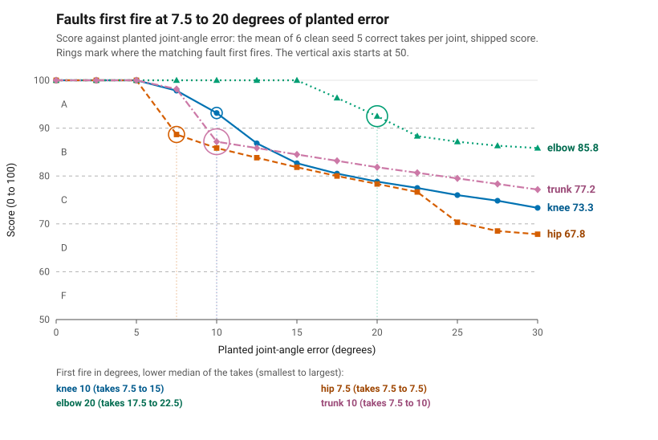

# Scoring validity: what the score does when a joint is wrong and when a take is changed

Part 5's share of TICKET-082 (the hub's rubric ticket 272). It is GPU free and works on skeletons, through Part 5's own
pipeline. Spec: `docs/specs/scoring-validity.md`. Every figure below is in `out/bench-score/metrics.json` (written by
`make bench-score`) or in the output of `uv run pytest -q tests/test_score_properties.py`.

The takes are the seed 5 synthetic takes (ASM-002): one generator made them, so a result here says the score is coherent
on that model, not that it is right for a real follower. The numbers were produced by `scripts/make_bench_score.py` at
`dde2aac` (score `simon.score.v3`, params `4261f8d7`); the same numbers came out at `71c98e4`, before the scripts were renamed. Failures are reported as found and listed for TICKET-083 at the end.

Not measured here: the video-level invariances (re-encode, 720p against 1080p, a 10% crop). They change what Part 2 sees,
so they need Part 2 GPU reruns. That belongs to whoever runs Parts 2 to 5 together (Part 7), using this bench as the scorer:
`scripts/make_score_validity.py` (`analyse`, `outcome`, `invariance_row`) takes any pair of clips and returns the score and the
fault set the tables below are made of.

## 1. Dose-response

An error of 0 to 30 degrees (13 steps of 2.5) is planted in every frame of a correct take by rotating the distal segment
about the joint, with the generator's geometry (`scripts/make_dummy_followers.py`): the left ankle about the left knee
(more bend), the left leg about the left hip (away from the midline), the left wrist about the left elbow (forward), the head,
shoulders and arms about the hip midpoint (forward lean). Six takes: the correct takes 00 and 01 of the exercise set at the
front, 45 and side angles, good light, clean. 312 rows. The pipeline runs with the shipped rules and no feet file.



| Joint | Matching fault | First fire, lower median of 6 takes (range) | Score at 0 | at 10 | at 20 | at 30 |
|---|---|---|---|---|---|---|
| knee | `knee_flexion` more, left | 10 degrees (7.5 to 15) | 100 A | 93.2 (85 to 100) A or B | 78.8 (77 to 80) B or C | 73.3 (72 to 75) C |
| hip | `foot_out` more, left | 7.5 degrees (7.5 to 7.5) | 100 A | 85.8 (85 to 86) B | 78.3 (78 to 79) C | 67.8 (64 to 75) C or D |
| elbow | `elbow_flexion` more, left | 20 degrees (17.5 to 22.5) | 100 A | 100 (100 to 100) A | 92.5 (88 to 100) A or B | 85.8 (85 to 86) B |
| trunk | `trunk_lean_forward` more, center | 10 degrees (7.5 to 10) | 100 A | 87.2 (86 to 88) B | 81.8 (81 to 82) B | 77.2 (77 to 78) C |

The score cells are the mean over the six takes, with the lowest and highest value and the grades the takes got. The matching
fault of the hip is `foot_out` (the rules drop `thigh_out` when `foot_out` fires, `explained_by`). First fire per take:

| Joint | front 00 | front 01 | 45 00 | 45 01 | side 00 | side 01 |
|---|---|---|---|---|---|---|
| knee | 10 | 7.5 | 12.5 | 15 | 12.5 | 10 |
| hip | 7.5 | 7.5 | 7.5 | 7.5 | 7.5 | 7.5 |
| elbow | 17.5 | 17.5 | 22.5 | 20 | 20 | 22.5 |
| trunk | 7.5 | 10 | 10 | 10 | 10 | 10 |

What the rows show:

- The score does not rise with the error. All 24 series (4 joints, 6 takes) are non-increasing, and the committed-take test
  (`tests/test_score_monotone.py`, take `exercise_front_good_00_correct`) asserts it exactly for all four joints. No xfail was needed.
- The matching fault fires at every joint and stays on at every larger step in all 24 series.
- The score is a step at the first fire. The 116 rows without the matching fault score exactly 100 and report no other fault. The
  196 rows with it score 64 to 89, none an A. On the step where a take first fires, its score drops by 11 to 15 points. So below the
  first-fire angle the score carries no information about the size of the error. After it, each 2.5 degree step costs 3 points or
  fewer, except where the hip's second fault appears (up to 12 points). This is the shipped design (`score-v3.md`: a base penalty per fault, and a ceiling of 89 for a take that reports a
  fault); it is the shape a reader of the grade should know.
- The first-fire angle is planted degrees on top of each take's own difference from the example, so it is not the rule's threshold
  (`part5/rules.json`: `elbow_flexion` 20, `knee_flexion` 10, `foot_out` 6, `trunk_lean_forward` 9 degrees).
- The hip error brings a second fault: `knee_valgus` left, direction less, in 4 of 6 takes, from 25 degrees. The hip's scores at 30
  degrees range from 64 to 75, the widest range of the four joints.
- The harness is precise. The realised change in the joint's own measure differs from the planted degrees by at most 0.25 for
  the knee, 0 for the hip and the trunk, and 1.2 for the elbow. The chart's axis is the planted degrees.

## 2. Invariance on skeletons

54 takes (good light, clean, numbers 00 to 08 of the exercise and dance sets, correct and faulted). Each row is a transform of
the follower (the example too where it says so). The change is the transformed score minus the untransformed score of the same
take. A row is `exact` only when no score moved and every fault set is equal (for the mirror, after the sides are swapped and the
two lateral measures change direction).

| Transform | Group | Takes | Refused | Score changed | Largest change | Range | Fault set changed | Verdict |
|---|---|---|---|---|---|---|---|---|
| `fps_60` | all | 54 | 0 | 7 | 4 | -4 to 1 | 1 | fault set changed |
| `fps_24` (extra) | all | 54 | 0 | 5 | 10 | -10 to 1 | 1 | fault set changed |
| `mirror_follower` | symmetric example (exercise) | 27 | 0 | 0 | 0 | 0 | 0 | exact |
| `mirror_follower` | asymmetric example (dance, no claim) | 27 | 0 | 27 | 100 | -100 to -64 | 27 | fault set changed |
| `mirror_both` | all | 54 | 0 | 0 | 0 | 0 | 0 | exact |
| `trim_0.5s` | lead-in at least 15 frames | 4 | 0 | 1 | 1 | -1 to 0 | 0 | score moved |
| `trim_0.5s` | lead-in under 15 frames (no claim) | 50 | 0 | 21 | 82 | -82 to 8 | 10 | fault set changed |
| `trim_lead_in` (extra) | all with a lead-in | 47 | 0 | 7 | 10 | -10 to 2 | 2 | fault set changed |
| `translate_5mm` | all | 54 | 0 | 0 | 0 | 0 | 0 | exact |
| `translate_0.5m` | all | 54 | 54 | n/a | n/a | n/a | n/a | refused (`InputError`) |
| `yaw_5` | all | 54 | 0 | 18 | 10 | -10 to 8 | 2 | fault set changed |
| `yaw_15` | all | 54 | 0 | 43 | 34 | -34 to 11 | 29 | fault set changed |
| `yaw_45` | all | 54 | 0 | 54 | 85 | -85 to -41 | 54 | fault set changed |
| `yaw_45_both` | all | 54 | 0 | 36 | 55 | -55 to 15 | 26 | fault set changed |
| `scale_0.8` | all | 54 | 0 | 0 | 0 | 0 | 0 | exact |
| `scale_1.25` | all | 54 | 0 | 0 | 0 | 0 | 0 | exact |

Held, exactly: the mirror of both clips (54 of 54), the mirror of the follower against a left-right symmetric example (27 of 27),
a translation within 1 cm (54 of 54), a uniform scale (54 of 54 at 0.8 and at 1.25). A translation of 0.5 m is refused with an
`InputError` in all 54, as the contract says: the hip midpoint must be at the origin.

Not held:

- **Frame rate.** A 60 frames per second follower moves 7 of 54 scores (largest 4 points, one fault set: dance take
  `dance_side_good_08_arms_wider-both+foot_out-left` reports `upper_arm_out` on the left at 30 fps and on both sides at 60). The 7 are
  faulted takes; the 12 correct takes do not move. Suspected cause, not proven by a committed test: `part5/normalise.py` smooths over
  5 frames whatever the clip's rate, so a 60 fps follower is smoothed over half the time before it is resampled to the example's
  clock. The 24 fps row, a non-integer ratio, moves 5 takes by up to 10 points.
- **Trim.** A 0.5 s trim moves 1 of the 4 takes whose idle lead-in is at least 15 frames, by 1 point (`dance_front_good_05_elbow_bent-left`,
  88 to 87). A take with a shorter lead-in loses the first moves of the squat as well, which is a different performance, so that group
  makes no claim; it moves 21 of 50 takes, up to 82 points. The cleaner row removes only each take's own idle lead-in: it moves 7 of 47
  takes (all in the dance set, 7 of 23; none in the exercise set, 0 of 24), by up to 10 points, with 2 fault sets changed.
- **Yaw.** Turning the follower about the vertical moves the score and the fault set. At 5 degrees 18 of 54 scores move (the 12
  correct takes do not); at 15 degrees 43 of 54 move and 8 of the 12 correct takes gain a fault; at 45 degrees all 54 lose between 41 and
  85 points. Turning the example too (`yaw_45_both`) still moves 36. The cause is the contract's frame: the measures read the subject's
  x and z axes (`part5/measures.py`), ASM-001 puts the input in that frame, and nothing in `part5/normalise.py` turns a clip back, so a
  yaw is outside the contract. It still means a skeleton that arrives with a heading error, from Part 3 or an estimator, is scored on
  it.
- **Mirror of the follower against an asymmetric example.** The dance example is not left-right symmetric, so its mirrored follower is a
  different movement (27 of 27 moved, 64 to 100 points lower). No claim is made for that group.

## 3. Properties

`tests/test_score_properties.py`, `hypothesis` with `derandomize=True`, no deadline, no example database and 6 examples per property
(the yaw property up to 12), on committed seed 5 takes and the committed example clips. The file runs in 9 s wall on a host with a
load under 40 (the limit is 60 s).

| Id | Property | Result |
|---|---|---|
| P1 | `score.value` is an integer in 0..100 and `score.grade` is its band, with a planted error up to 60 degrees, added noise and a take of the other movement; a take with a warning is at most 59 | holds |
| P2 | an example compared with itself (exercise, dance, part3-squat; as a file and as a copy) scores 100, A, no fault, no warning | holds |
| P3 | a translation within 1 cm changes nothing; one beyond it is an `InputError` that says the hip midpoint must be at the origin | holds |
| P4 | a yaw of the follower between -45 and 45 degrees (1 degree or more) changes nothing | fails, `xfail(strict=True)`, TICKET-083 |
| P5 | a uniform scale from 0.5 to 2 changes nothing | holds |
| P6 | mirroring both clips swaps the sides of the faults, turns the lateral measures and changes nothing else | holds |
| P7 | a NaN or infinite coordinate, in either clip, is an `InputError` naming the first bad frame and joint | holds |
| P8 | frames with every joint null are hidden measures: with up to 40% empty a correct take still scores 100 with no fault; with 60% or more empty it carries `no_usable_measures`, scores at most 59 and reports no fault | holds |

P4 fails on its first falsifying example under this seed: `exercise_front_good_00_correct` yawed by 16 degrees goes from 100 to 79
(`uv run pytest -q tests/test_score_properties.py -k p4 --runxfail`).

The documented limit of P8 is half the frames (`MIN_AVAILABLE` in `part5/pipeline.py`); the margins keep the test off that
boundary. Below it, the score does not say how much of the take was measured: a take with 40% of its frames empty scores as a
complete one.

## 4. Failures found, for TICKET-083

None of these can be fixed without a change that moves every score or the frozen rules, so none was fixed here.

1. **Yaw changes the score** (P4 xfail; table rows `yaw_5` to `yaw_45_both`). Fixing it needs a heading normalisation, which would
   change what the pipeline does to every take, the frozen seed 5 takes included: a design change for the frozen family, not a patch.
2. **Frame rate changes the score** (`fps_60`, `fps_24`). The suspect is the smoothing window in frames in `part5/normalise.py`. No
   property test covers it yet.
3. **A trim of idle frames can change the score** (`trim_0.5s` with a long lead-in: 1 of 4; `trim_lead_in`: 7 of 47, all dance). Not
   traced.
4. **A large hip error brings a second fault** (`knee_valgus` left less, from 25 degrees). Recorded in the rows, not a failure of the score.

## Reproduce

```bash
uv run make bench-score                                  # out/bench-score/metrics.json and dose-response.svg, and the copy under docs/evaluation/
uv run pytest -q tests/test_score_validity.py tests/test_score_monotone.py tests/test_score_properties.py
```
